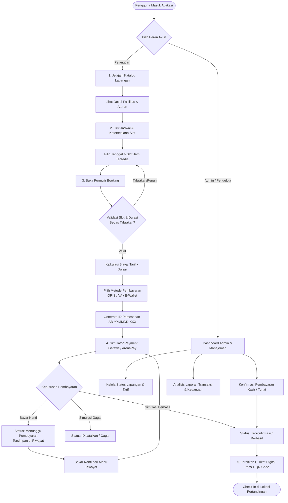
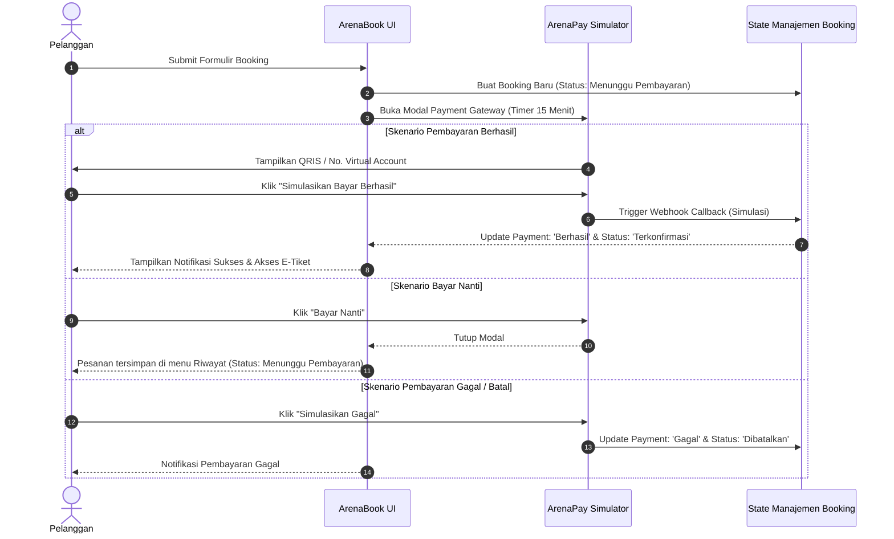
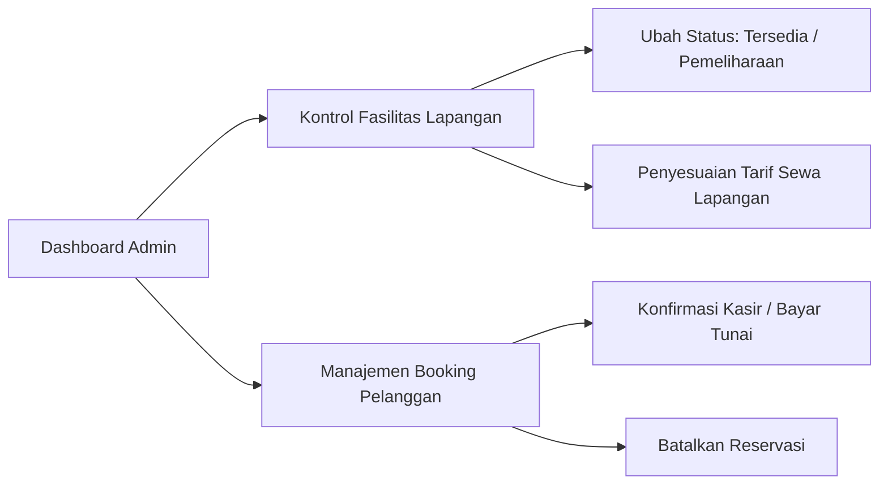

# Dokumentasi Alur Kerja Sistem (System Workflow) — ArenaBook

Dokumen ini menjelaskan alur kerja (*system workflow*), proses bisnis, interaksi antar komponen, dan transisi status dalam aplikasi **ArenaBook** (Sistem Informasi Booking Lapangan Olahraga Berbasis Web dengan Payment Gateway).

---

## 1. Ikhtisar Sistem & Aktor Pengguna

ArenaBook dirancang untuk pengelolaan reservasi lapangan olahraga (*single-venue*) dengan dua peran utama:

| Aktor | Peran & Akses |
| :--- | :--- |
| **Pelanggan (Customer)** | Menjelajahi katalog lapangan, cek ketersediaan slot jadwal real-time, reservasi slot lapangan (*Smart Collision Detection*), simulasi pembayaran payment gateway, memantau riwayat booking, dan mencetak E-Tiket (Digital Pass). |
| **Admin / Pengelola** | Memantau ringkasan KPI operasional, mengatur status operasional lapangan (Tersedia / Pemeliharaan), mengubah tarif sewa, konfirmasi pembayaran kasir (tunai), membatalkan pesanan, menganalisis laporan omzet keuangan, dan mengelola otorisasi akun pengguna. |

### 1.1 Matriks Pengaturan Hak Akses

Berdasarkan arsitektur keamanan sistem, hak akses dibagi secara tegas antar peran:

| Fitur | Pelanggan | Admin |
| :--- | :---: | :---: |
| **Registrasi akun** | ✓ | — |
| **Login** | ✓ | ✓ |
| **Booking lapangan** | ✓ | ✓ |
| **Pembayaran** | ✓ | ✓ |
| **Kelola jadwal lapangan** | — | ✓ |
| **Kelola data lapangan** | — | ✓ |
| **Kelola laporan** | — | ✓ |
| **Kelola pengguna** | — | ✓ |

> [!IMPORTANT]
> **Prinsip Keamanan Sistem:**
> 1. Pilihan peran Admin dan Pelanggan ditiadakan dari formulir registrasi umum.
> 2. Setiap pengguna yang mendaftar melalui registrasi publik secara otomatis mendapatkan peran `Pelanggan`.
> 3. Akun Admin tidak dapat dibuat melalui registrasi publik. Pembuatan akun Admin hanya dapat dilakukan oleh **Admin Utama** melalui panel khusus terotorisasi (*Konsol Manajemen Admin*).
> 4. Validasi keamanan diterapkan pada level handler/backend untuk mencegah manipulasi peran oleh pengguna.
> 5. Pengguna dengan peran Pelanggan tidak diperbolehkan mengakses dashboard atau konsol Admin.

---

## 2. Diagram Alur Utama (End-to-End User Journey)

---

## 3. Rincian Tahapan Alur Kerja

### Tahap 1: Registrasi, Login & Otorisasi Pengguna

1. **Registrasi Akun Baru (Publik):**
   - Halaman registrasi umum diperuntukkan khusus bagi calon pelanggan.
   - Formulir registrasi mencakup:
     * **Nama Lengkap**
     * **Email**
     * **Nomor WhatsApp**
     * **Password** (min. 6 karakter)
     * **Konfirmasi Password**
     * **Checkbox Persetujuan Ketentuan Layanan**
     * Tombol **"Buat Akun & Masuk Sekarang"**
   - *Keamanan Ketat:* Pilihan peran ditiadakan; sistem otomatis menetapkan peran `Pelanggan` (*Customer*). Pengguna umum tidak dapat membuat atau memilih peran Admin.

2. **Login Sistem:**
   - Pelanggan dan Admin masuk melalui form login menggunakan email / nomor WhatsApp dan password terdaftar.
   - Tersedia asisten kredensial demo 1-klik untuk kemudahan pengujian.
   - Tersedia tombol **Keluar (Logout)** yang mengembalikan sistem ke mode tamu (*guest*).

3. **Proteksi Akses Khusus Admin:**
   - Pengguna dengan peran Pelanggan tidak diperbolehkan mengakses halaman Dashboard Admin maupun Laporan Keuangan.
   - Pembuatan akun Admin baru hanya dapat diotorisasi oleh **Admin Utama** melalui fitur **Kelola Pengguna** di dalam Dashboard Admin.

---

### Tahap 2: Eksplorasi & Pengecekan Jadwal
1. **Katalog Lapangan:**
   - Menampilkan lapangan resmi: **Ben Stadium** (Futsal) & **Lapangan Bulu Tangkis Panggulaan** (Badminton).
   - Menyediakan modal detail spesifikasi teknis (material lantai, penerangan lux, dimensi standar BWF/FIFA, fasilitas, dan tata tertib).
2. **Matriks Jadwal Interaktif:**
   - Operasional jam 08:00 – 22:00 WIB.
   - Pembedaan status visual:
     - 🟩 **Hijau (Tersedia):** Slot dapat diklik langsung untuk membuat reservasi.
     - ⬜ **Abu-abu / Disabled (Terisi):** Slot telah dipesan orang lain dan tidak dapat dipilih.

---

### Tahap 3: Pembuatan Booking & Smart Collision Detection
1. Pelanggan memilih tanggal, jam mulai, dan durasi sewa (1, 2, atau 3 jam).
2. **Pencegahan Jadwal Ganda (*Collision Detection*):**
   - Sistem memeriksa seluruh rentang jam dari `jam_mulai` hingga `jam_mulai + durasi`.
   - Jika ada salah satu jam dalam rentang tersebut yang sudah dipesan untuk tanggal dan lapangan yang sama, sistem otomatis menolak dan memberi peringatan.
3. Perhitungan total biaya transparan:
   $$\text{Total Tagihan} = \text{Tarif Sewa per Jam} \times \text{Durasi (Jam)}$$
4. Sistem membuat kode pemesanan resmi berformat: `AB-YYMMDD-XXX` (contoh: `AB-261021-084`).

---

### Tahap 4: Simulasi Payment Gateway (*ArenaPay Sandbox*)

---

### Tahap 5: E-Tiket & Riwayat Pemesanan
1. Booking yang berstatus **Terkonfirmasi** memiliki tombol **"Lihat E-Tiket"**.
2. Modal E-Tiket menampilkan:
   - Tiket Digital Pass resmi berlogo ArenaBook.
   - Kode QR untuk verifikasi check-in di pintu venue.
   - Rincian jadwal, lapangan, durasi, dan nama pemesan.
   - Tombol cetak / unduh tiket.
3. Booking yang berstatus **Menunggu Pembayaran** menampilkan tombol **"Bayar Sekarang"** untuk membuka kembali simulator pembayaran.

---

### Tahap 6: Pengelolaan Operasional oleh Admin

1. **Kontrol Lapangan:**
   - Status lapangan dapat diubah menjadi *Pemeliharaan* (secara otomatis mengunci jadwal booking).
   - Tarif per jam dapat diperbarui secara dinamis.
2. **Konfirmasi Kasir (On-the-spot Settlement):**
   - Pelanggan yang datang langsung ke meja resepsionis dapat dikonfirmasi pembayarannya secara manual oleh admin kasir.
   - Status langsung berubah menjadi *Berhasil* dan *Terkonfirmasi*.

---

### Tahap 7: Laporan Transaksi & Keuangan
1. **Filter Periode:** Hari ini, 7 hari terakhir, 30 hari terakhir, Bulan ini, atau Semua data demo.
2. **Kaidah Integritas Keuangan SOT:**
   - Hanya transaksi dengan status pembayaran **Berhasil** yang dihitung ke dalam total pendapatan / omzet kas masuk.
   - Transaksi *Tertunda* atau *Gagal* dikecualikan dari perhitungan pendapatan riil.
3. **Analitik Visual:**
   - Grafik batang perolehan omzet.
   - Diagram proporsi kanal pembayaran (QRIS, VA, E-Wallet).
   - Tingkat okupansi lapangan (Futsal vs Badminton).

---

## 4. Matriks Transisi Status (State Transition)

| Status Booking | Status Pembayaran | Penjelasan Kondisi | Aksi yang Tersedia |
| :--- | :--- | :--- | :--- |
| `Menunggu Pembayaran` | `Tertunda` | Booking telah dibuat, menunggu transfer / scan QRIS. | Pelanggan dapat *Bayar Sekarang* atau *Batalkan*. Admin dapat *Konfirmasi Kasir*. |
| `Terkonfirmasi` | `Berhasil` | Pembayaran lunas (simulasi gateway sukses atau konfirmasi kasir). Slot jadwal terkunci. | Pelanggan dapat membuka dan mencetak *E-Tiket*. Admin dapat membatalkan jika darurat. |
| `Dibatalkan` | `Gagal` | Waktu bayar habis, simulasi gagal, atau dibatalkan pengguna/admin. Slot kembali kosong. | Tidak ada aksi aktif; riwayat dicatat untuk audit. |

---

## 5. Batasan Front-End Prototype vs Rencana Integrasi Backend

| Aspek | Kondisi Saat Ini (Frontend Prototype) | Kebutuhan Tahap Integrasi Nyata (Backend) |
| :--- | :--- | :--- |
| **Penyimpanan Data** | State lokal React (*in-memory* & seed data dummy). | Database relasional (PostgreSQL / MySQL) dengan transaksi ACID. |
| **Payment Gateway** | Simulator UI antarmuka (*ArenaPay Sandbox*). | Integrasi Payment Gateway resmi (Midtrans / Xendit / DOKU). |
| **Verifikasi Pembayaran** | Tombol klik front-end memicu perubahan state. | **Wajib Webhook Server-to-Server** dengan verifikasi Signature Key kriptografis. Redirect browser tidak boleh dijadikan bukti sah pembayaran. |
| **Keamanan & Otorisasi** | Switch akun demo berbasis UI mock. | JWT / OAuth2 berbasis token, password hash (bcrypt), dan RBAC (*Role-Based Access Control*). |
| **Notifikasi** | Notifikasi toast lokal di layar. | Pengiriman pesan otomatis via WhatsApp Business API / Email SMTP. |

