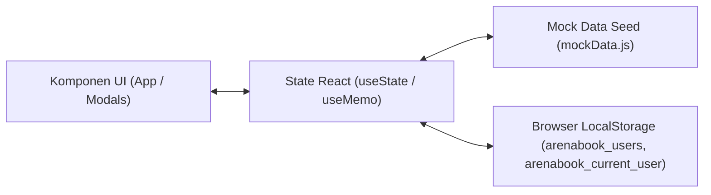

# TEKNOLOGI DAN ARSITEKTUR SISTEM ARENABOOK

Dokumen ini menjelaskan secara rinci seluruh tumpukan teknologi (*technology stack*), pustaka (*libraries*), kakas bantu (*tools*), serta arsitektur data pada proyek sistem informasi booking lapangan **ArenaBook**.

---

## 1. Ringkasan Karakteristik Sistem

> [!IMPORTANT]
> **Karakteristik Proyek: Front-End Only (Prototipe / Simulasi)**  
> Aplikasi **ArenaBook** dibangun sepenuhnya pada sisi klien (*client-side front-end only*). Sistem ini **belum menggunakan server backend dan belum terhubung ke sistem basis data (database) riil** (seperti MySQL, PostgreSQL, atau MongoDB).  
> 
> Seluruh alur kerja operasional (katalog lapangan, jadwal slot waktu, registrasi akun, pemesanan, simulasi payment gateway, hingga laporan omzet) beroperasi menggunakan **Data Dummy (Mock Data)** dan mekanisme penyimpanan lokal peramban (*browser LocalStorage*).

---

## 2. Rincian Teknologi yang Digunakan

### A. Bahasa Pemrograman

| Bahasa | Penggunaan dalam Sistem |
|---|---|
| **JavaScript (ES6+)** | Menangani logika bisnis aplikasi, validasi form, manipulasi array data pemesanan, kalkulasi biaya dinamis, algoritma pencegahan bentrok jadwal (*collision avoidance*), dan manajemen state antarmuka. |
| **HTML5** | Menyusun struktur semantik halaman web, kontrol form standar (`<input>`, `<select>`, `<button>`), serta atribut aksesibilitas (*ARIA attributes*). |
| **CSS3 (Modern CSS)** | Mengatur tata letak antarmuka dengan *CSS Grid* dan *Flexbox*, animasi transisi, *media queries* untuk responsivitas layar ponsel, dan variabel desain (*CSS Custom Properties / Tokens*). |

---

### B. Framework & Pustaka Utama (Libraries)

| Teknologi / Library | Versi / Tipe | Peran & Alasan Penggunaan |
|---|---|---|
| **React** | Versi Terbaru (React 18/19) | Library JavaScript deklaratif berbasis komponen (*component-based*). Digunakan untuk membangun UI modular (seperti Modal Booking, Kartu Lapangan, Admin Panel, dan E-Tiket) dengan siklus hidup state reaktif (`useState`, `useEffect`, `useMemo`). |
| **ReactDOM** | Versi Terbaru | Jembatan pengikat antara komponen virtual React dengan elemen Document Object Model (DOM) peramban. |
| **Tailwind CSS** | v4 (Integrasi Vite) | Framework CSS *utility-first* untuk mempercepat *styling* modern, konsistensi *spacing*, serta tata letak responsif. |
| **Lucide React** | `lucide-react` | Kumpulan ikon vektor berbasis SVG yang konsisten, bersih, dan ringan untuk visualisasi menu, status badge, tombol aksi, dan kontrol form. |

---

### C. Build Tools & Lingkungan Pengembangan (Development Tools)

| Alat / Kakas | Fungsi dalam Proyek |
|---|---|
| **Vite** (`@vitejs/plugin-react`) | *Next Generation Frontend Tooling* / *bundler* aplikasi web. Menyediakan server pengembangan lokal yang sangat cepat dengan fitur *Hot Module Replacement* (HMR) dan optimalisasi *bundle production*. |
| **Node.js & npm** | *Runtime environment* dan manajer paket (*package manager*) untuk memasang, memperbarui, dan mengelola dependensi proyek. |
| **Google Fonts (Plus Jakarta Sans)** | Tipografi tunggal sans-serif modern dengan bobot 400 hingga 800 yang dioptimalkan untuk keterbacaan antarmuka digital. |

---

## 3. Penjelasan Pengelolaan Data (Tanpa Database)

Karena proyek berstatus *Front-End Prototype*, sistem penyimpanan data dirancang dengan skema mandiri:

### 1. Sumber Data Awal (*Seed / Mock Data*)
- Disimpan terpusat di dalam berkas [mockData.js](file:///c:/Users/INFINIX%20USER/Downloads/ArenaBook-SOT-Frontend/ArenaBook/src/data/mockData.js).
- Berisi data 2 lapangan resmi (Ben Stadium & Lapangan Bulu Tangkis Panggulaan), daftar slot jam operasional (08.00–22.00), akun demo (Admin & Pelanggan), serta pemesanan awal dengan tanggal relatif.

### 2. Persistensi Data Lokal (*Web Storage API*)
- **`localStorage`**: Digunakan untuk menyimpan pengguna baru hasil registrasi, perubahan peran pengguna (*role updates*), dan sesi pengguna aktif agar data tidak langsung hilang saat halaman di-*refresh*.
- **State Memori Klien**: Data transaksi pemesanan baru disimpan di dalam state React level induk (`App.jsx`) selama sesi aplikasi berjalan.

### 3. Simulasi Transaksi & Payment Gateway
- Modul pembayaran **bukan koneksi API perbankan nyata**, melainkan antarmuka simulasi (*sandbox demo*) yang menyimulasikan:
  - Batas waktu pembayaran (penghitung waktu mundur 15 menit).
  - Pilihan metode bayar (QRIS, Nomor Virtual Account BCA/Mandiri terformat, E-Wallet, dan Kasir Tunai).
  - Pemanggilan *callback webhook* buatan yang mengubah status dari `Menunggu Pembayaran` menjadi `Terkonfirmasi (Lunas)` atau `Dibatalkan (Gagal)`.

---

## 4. Keuntungan Pendekatan Front-End Prototype untuk Tugas / Sidang

1. **Portabilitas Tinggi:** Aplikasi dapat dijalankan di laptop mana pun cukup dengan `npm run dev` tanpa perlu menginstal dan mengonfigurasi DBMS server (seperti XAMPP, MySQL Server, atau Docker).
2. **Fokus pada Interaksi & Logika Bisnis:** Menguji secara mendalam pengalaman pengguna (*UI/UX*), pencegahan bentrok jadwal, dan pemisahan hak akses sebelum masuk ke tahap integrasi backend.
3. **Aman untuk Pengujian Akademik:** Mahasiswa dapat mendemonstrasikan proses registrasi, booking, dan pembayaran berkali-kali tanpa khawatir terhadap kegagalan transaksi perbankan atau kebocoran data sensitif.

